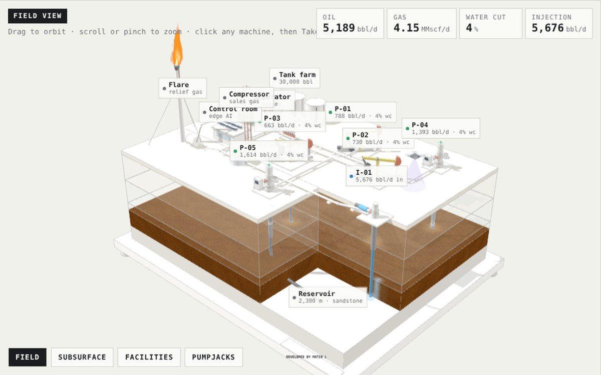
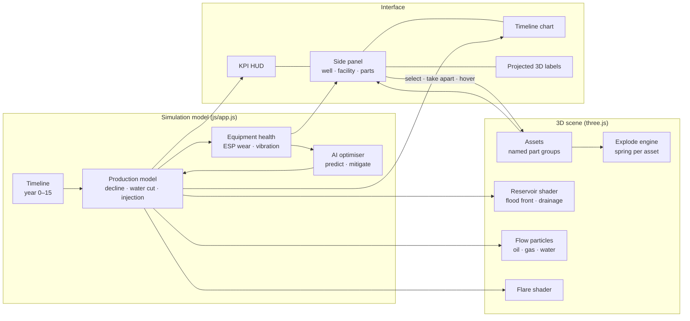

<div align="center">



# Digital Oil Field · 3D Twin

**A real-time, interactive 3D digital twin of a producing oil field, from the wellhead down to the reservoir, with an AI optimiser built in.**

Orbit the field · X-ray the reservoir · take every machine apart · run 15 years of production · let AI catch a failing pump before it stops the well

[](https://MatinShahin.github.io/digital-oil-field/)
[](https://github.com/wheresryan22/anatomy)
[](https://threejs.org)
[](LICENSE)


-lightgrey?style=flat-square)


[Live demo](#-live-demo) · [Features](#-features) · [Architecture](#-architecture) · [Models](#-engineering-models) · [Getting started](#-getting-started) · [Deployment](#-deployment) · [Built with Anatomy](#-built-with-anatomy) · [Author](#-author)

</div>

---

## Overview

Oil and gas operators run some of the most complex physical systems on earth, yet most of what happens in them is invisible: thousands of metres of steel in the ground, fluids moving through rock, machines wearing out a little every hour. **A digital twin makes that system visible, explorable and predictable.**

This project is a browser-native digital twin of a small oil field. It combines three layers in one live scene:

| Layer | What it shows |
|:--|:--|
| **Surface** | Wells, pumpjacks, ESPs, the production manifold, a three-phase separator, tank farm, gas compressor, produced-water handling, flare and control room |
| **Subsurface** | Rock strata, wellbores (including a horizontal lateral), and a sandstone reservoir with a waterflood front rendered by a custom shader |
| **Intelligence** | A production model over 15 years, per-well health monitoring, and an AI optimiser that predicts an ESP failure and acts on it |

Everything runs client-side, with no server, no build step and no install. It is one HTML page you can open, host or embed anywhere.

> **Note:** The field, its production model and all sensor data are illustrative. They are designed to be physically plausible and internally consistent, not to represent a real asset.

---

## 🚀 Live demo

**▶ [Open the live twin](https://MatinShahin.github.io/digital-oil-field/)**

| Try this | What happens |
|:--|:--|
| Drag, scroll or pinch | Orbit and zoom around the field |
| Press **Subsurface** | The camera dives below ground; the rock turns translucent and the flood front appears |
| Drag the **Field life** slider | 15 years of production play out across wells, KPIs and charts |
| Click **P-01**, then **Take apart** | The pumpjack separates into 11 labelled components, including the downhole pump pulled up from 2,300 m |
| Click **P-04** around year 7 | The AI flags a failing ESP bearing |
| Press **Apply AI optimisation** | The pump is slowed, chokes rebalanced, and the saved oil appears as a dashed line on the chart |

---

## ✨ Features

### 3D field and subsurface
- **Full-site model:** 6 wells, a manifold, a separator, 3 oil tanks, a gas compressor, a produced-water tank, a flare with guy wires, and a control room with solar array, comms tower and satellite dish.
- **X-ray ground:** translucent strata (soil, sand, shale, limestone, caprock, reservoir, basement) reveal every wellbore.
- **Reservoir shader:** oil saturation, drainage around each producer, and a noisy, physically motivated waterflood front that advances with time.
- **Living equipment:** pumpjacks stroke at their real rates, oil, gas and water particles flow through every line in their own colours, the flare responds to production, and an inspection drone patrols the site.

### Take-apart ("anatomy") mode
Every asset is built from **named, documented components** that explode apart in 3D on demand, in the style of the [Anatomy](https://github.com/wheresryan22/anatomy) project.

| Asset | Components revealed |
|:--|:--|
| Beam pump (×3) | Skid, samson post, walking beam, horsehead, crank and counterweights, pitman arms, gear reducer, prime mover, polished rod, **downhole rod pump**, **sucker-rod string** |
| ESP well (×2) | Tubing head, master valve, production tree, wing valve, gauge, variable-speed drive, **multistage pump, gas separator, seal section, motor, downhole sensor, power cable** |
| Water injector | Wellhead, injection pump, skid, flow meter and choke |
| Three-phase separator | Shell, heads, saddles, **inlet diverter, weir plate, oil and water layers, mist extractor**, sight glass, relief valve |
| Oil tanks (×3) | Bund, **stored crude, heating coil**, shell, roof, stair, radar level gauge |
| Gas compressor | Skid, **gas engine, compressor cylinders**, enclosure, exhaust |
| Control room | Building, **edge-AI server racks, operator consoles**, roof, solar array, comms tower, satellite dish |
| Flare, manifold, water tank | Stack, tip, pilot, knockout drum; header, diverter valves, transmitters; shell, roof, water |

Hover or tap any component, in the scene or in the side list, to highlight it and read what it does.

### Production and AI
- **15-year timeline** with play, pause and scrubbing; live KPIs for oil, gas, water cut and injection.
- **Per-well panels:** rate, water cut, liquid, stroke rate or vibration, and a 15-year sparkline.
- **AI optimiser:** detects a degrading ESP from rising vibration, predicts time to failure, and applies a mitigation that rebalances the field. The benefit is shown against the base case.

### Experience
- One-click camera flights: **Field**, **Subsurface**, **Facilities**, **Pumpjacks**.
- An obstruction-aware camera that chooses a clear view of whatever you select.
- Responsive from phone to widescreen, with touch orbit and pinch-zoom, light and dark themes, and reduced-motion support.

### Companion figures (`/figures`)
Four standalone interactive figures drawn with the [Anatomy](https://github.com/wheresryan22/anatomy) isometric kit:

| Figure | Highlights |
|:--|:--|
| **Digital wellhead and flare** | Christmas tree that explodes into 8 assemblies, WebGL flare tied to the choke, edge RTU with live screen |
| **ESP AI predictive maintenance** | 30 days of sensor data, AI warning about 6 days before a conventional alarm, thermal overlay of a failing bearing |
| **Hydrogen salt cavern** | Reciprocating compressor and wellhead, WebGL hydrogen volume that responds to injection and withdrawal |
| **CO₂ storage aquifer** | Multistage injection pump, pig receiver, and a plume that fingers through the aquifer over 25 years |

---

## 🏗 Architecture



**Design principles**
- **One source of truth:** every number on screen (KPIs, labels, charts, flare size, particle speed, flood front) is derived from the same model at the current time step.
- **Assets as data:** each machine is a list of `{ name, description, explodeDirection, geometry }` parts, so adding equipment never touches the explode, selection or labelling code.
- **No build tooling:** plain ES2017 and one CDN dependency, so it is easy to read, fork and host.

---

## 📐 Engineering models

| Quantity | Model |
|:--|:--|
| Well decline | Exponential: `q(t) = q₀ · e^(−D·t)`, with `D = 12 %/yr` |
| Flood front | Radial advance from the injector, `r_f = v·t`, perturbed by fractal noise for a realistic, irregular front |
| Water cut | Smooth rise from 4 % to ~92 % as the front reaches each producer (arrival time = distance / front speed) |
| Pressure support | Injection replaces **105 %** of produced liquid (voidage replacement ratio 1.05) |
| ESP degradation | Bearing wear `w(t) ∝ ((t − t₀)/τ)^2.4`; vibration `= 0.08 + 0.42·w` in/s; failure at year 9 without intervention |
| AI mitigation | Reduces drive frequency and bearing load, cutting wear growth by about 60 % and rebalancing chokes toward low-water-cut wells |

The companion figures carry their own documented models: Gilbert's choke correlation and an inflow line for the wellhead, a real-gas density law for hydrogen, and a volumetric plume-radius balance for CO₂.

---

## 🧰 Tech stack

| | |
|:--|:--|
| **Rendering** | [three.js](https://threejs.org) r128 with OrbitControls, PBR materials, PCF soft shadows and an edge overlay for a technical-drawing finish |
| **Shaders** | Custom GLSL for the reservoir and flare |
| **Figures** | [Anatomy](https://github.com/wheresryan22/anatomy) isometric SVG kit, plus WebGL layers |
| **UI** | Semantic HTML, CSS custom properties, IBM Plex Sans and Mono |
| **Hosting** | GitHub Pages via GitHub Actions |

---

## 📁 Project structure

```
digital-oil-field/
├── index.html                    3D digital twin: page shell, HUD, panels
├── css/
│   └── style.css                 theme tokens, layout, HUD and panel styles
├── js/
│   └── app.js                    scene, assets, shaders, models, AI, interaction
├── assets/
│   ├── matin-shahin.jpg          author photo
│   └── preview.jpg               social / README preview
├── figures/                      companion figures (Anatomy kit)
│   ├── digital-wellhead.html
│   ├── esp-ai-digital-twin.html
│   ├── hydrogen-salt-cavern.html
│   └── co2-storage.html
├── .github/workflows/pages.yml   CI: deploy to GitHub Pages on push
├── .nojekyll
├── LICENSE
└── README.md
```

---

## ⚙️ Getting started

**Requirements:** any modern browser with WebGL (Chrome, Edge, Firefox or Safari).

```bash
git clone https://github.com/MatinShahin/digital-oil-field.git
cd digital-oil-field

# serve locally (any static server works)
python3 -m http.server 8000
# open http://localhost:8000
```

You can also open `index.html` directly from disk.

---

## 🌐 Deployment

The repository ships with a GitHub Actions workflow that publishes the site on every push to `main`.

1. Create a public repository named `digital-oil-field` under [github.com/MatinShahin](https://github.com/MatinShahin) and push this folder to it.
2. Go to **Settings → Pages → Build and deployment → Source** and choose **GitHub Actions**.
3. Wait for the **Deploy to GitHub Pages** workflow to finish (about 1 minute).
4. Your twin is live at `https://MatinShahin.github.io/digital-oil-field/`.

> **Social previews:** `index.html` already points `og:image` at `https://matinshahin.github.io/digital-oil-field/assets/preview.jpg`. If you rename the repository, update that URL.

The site is fully static, so it also deploys unchanged to Netlify, Vercel, Cloudflare Pages or any web server.

---

## 🛠 Customisation

| To change | Edit |
|:--|:--|
| Wells, locations, rates | the `WELLS` array in `js/app.js` |
| Decline rate, flood speed | the `D` and `FRONT_SPEED` constants |
| Rock layers and colours | the `LAYERS` array |
| A machine's components | its builder function (`pumpjack`, `espSurface`, `injector`, facility blocks). Each `part(asset, name, description, explodeDirection, build)` call is one component |
| Colours and fonts | the CSS custom properties at the top of `css/style.css` |

---

## 🗺 Roadmap

- [ ] Live data connectors (OPC UA / MQTT / REST) to drive the twin from real SCADA tags
- [ ] Reservoir import from simulation output (Eclipse/OPM grids)
- [ ] ML anomaly-detection models running in the browser (ONNX Runtime Web)
- [ ] Scenario comparison: oil price, carbon price and energy cost against NPV and emissions
- [ ] CCUS and hydrogen-storage twins built on the same engine
- [ ] WebXR mode for headset walkthroughs

---

## 🦴 Built with Anatomy

This project uses and is inspired by **[Anatomy](https://github.com/wheresryan22/anatomy)** by [@wheresryan22](https://github.com/wheresryan22): *"an agent skill for creating detailed, interactive isometric illustrations of real-world machines and complex systems."*

- The four companion figures in `/figures` are built with Anatomy's drawing kit: its isometric camera, solid and lathe primitives, tube routing, painter's-order engine, WebGL layer and line-end and geometry checks.
- The 3D twin's **take-apart mode**, its idea that *the object is the explanation*, its rule that every number comes from the model, and its finish (thin edges, restrained palette, one lit accent) all follow Anatomy's craft principles.

If you build technical visualisations, Anatomy is worth a ⭐.

---

## 👤 Author

<table>
  <tr>
    <td width="120" valign="top"></td>
    <td valign="top">
      <b>Matin Shahin</b><br>
      AI Entrepreneur · Principal Applied AI Research Engineer<br><br>
      ✉️ <a href="mailto:matin.shahin97@gmail.com">matin.shahin97@gmail.com</a><br>
      🐙 <a href="https://github.com/MatinShahin">github.com/MatinShahin</a><br><br>
      Building applied AI and digital-twin systems for energy: production optimisation, predictive maintenance, and the transition technologies of hydrogen and carbon storage.
    </td>
  </tr>
</table>

Questions, collaboration or deployment for a real asset: get in touch.

---

## 📄 License

Released under the [MIT License](LICENSE). © 2026 Matin Shahin.

Third-party: [three.js](https://github.com/mrdoob/three.js) (MIT) · [Anatomy](https://github.com/wheresryan22/anatomy) (MIT).

## 📚 Citation

```bibtex
@software{shahin_digital_oil_field_2026,
  author = {Shahin, Matin},
  title  = {Digital Oil Field: An Interactive 3D Digital Twin},
  year   = {2026},
  url    = {https://github.com/MatinShahin/digital-oil-field},
  note   = {Built with Anatomy (https://github.com/wheresryan22/anatomy) and three.js}
}
```

<div align="center"><sub>Developed by <b>Matin Shahin</b> · Built with <a href="https://github.com/wheresryan22/anatomy">Anatomy</a> and <a href="https://threejs.org">three.js</a></sub></div>
